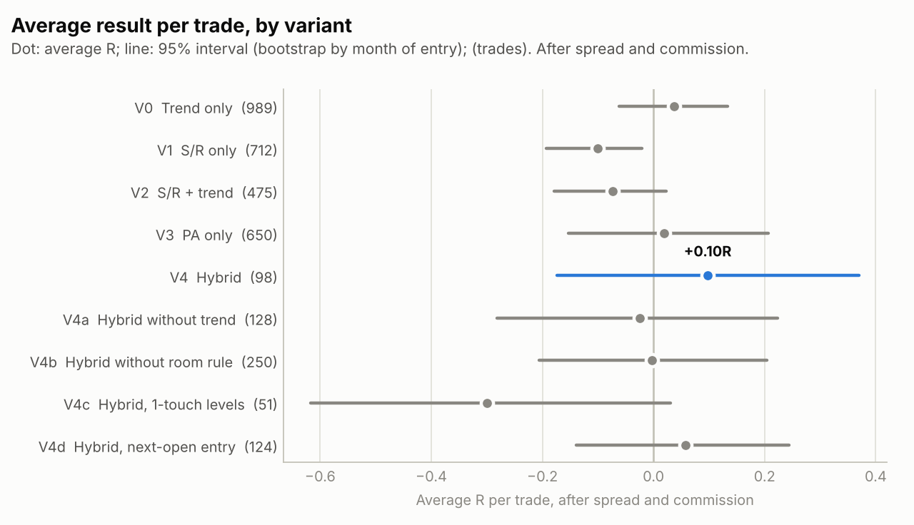
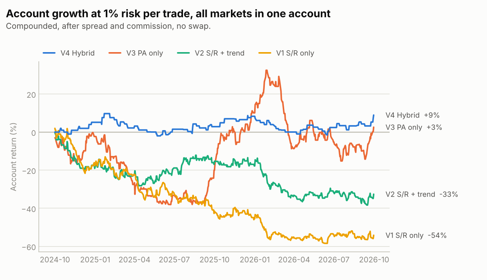
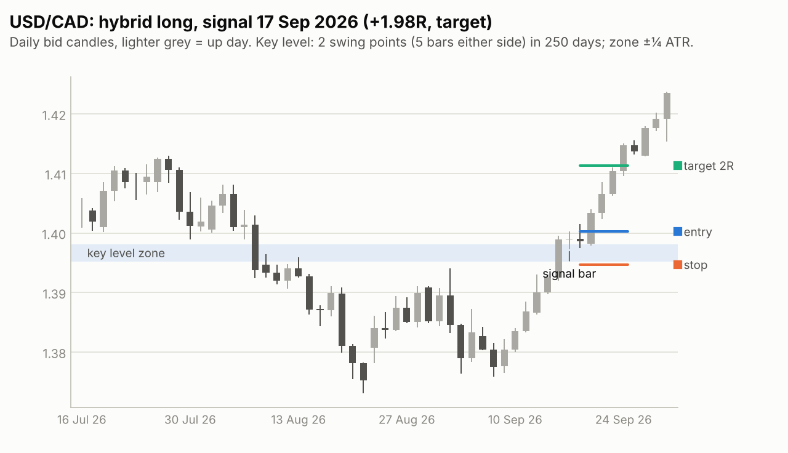
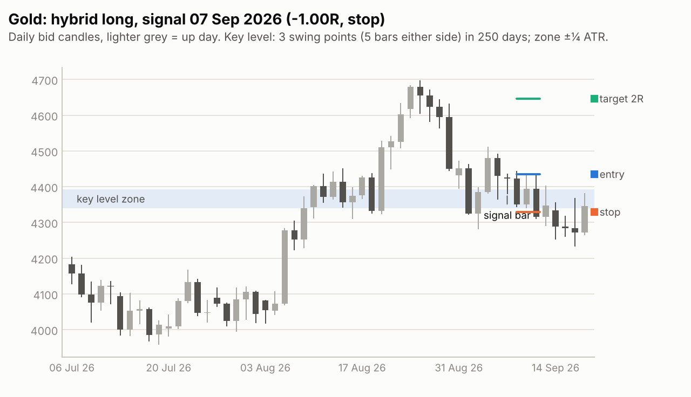

# Backtest: the hybrid against its parts, October 2024 – September 2026

The rules in [STRATEGY.md](STRATEGY.md), committed before any backtest, run mechanically on real
Dukascopy prices for 15 markets over **the last 24 months of data, 1 October 2024 – 30 September
2026.** The question: **does combining price action with support and resistance give an edge that
neither has alone, after real trading costs?**

## Verdict

**A small profit over the last two years, but not proof of an edge.** In the 24-month window the
hybrid:

- took **98 trades** across 15 markets, won **44%** of them and averaged **+0.10R per trade** after
  spread and commission. Risking 1% per trade in one account, $10,000 would have become
  **$10,896** (+4.4% a year), with an **11% maximum drawdown**.
- had the **best result per trade of all nine variants**, and a much smaller drawdown than its
  parts (11%, against 38–59% for PA only, trend only and the two S/R variants, which trade far
  more often). The parts: trend only +0.04R, PA only +0.02R, S/R + trend −0.07R, S/R only −0.10R.
  S/R only is the one result here that is clearly below zero.
- is **not distinguishable from zero.** Its 95% interval runs from −0.17R to +0.37R per trade, and
  24% of resamples came out at zero or worse. 98 trades cannot separate an edge of this size from
  luck.
- **did worse over the long run.** The same rules over January 2008 – September 2026 (run before
  the window was narrowed) averaged **−0.07R per trade over 701 trades**, with forex at −0.18R. The
  last two years were a good stretch for this strategy, not its norm.
- made its money on **stock-index longs**: +0.40R per trade over 29 trades, against +0.17R for PA
  only and +0.04R for trend only in the same markets. Forex was roughly flat (−0.05R over 51
  trades).

## How the test works

- **Window:** trades enter from 1 October 2024 and the data ends on 30 September 2026. Earlier
  history (from 2007; from 2013 for the index and oil CFDs, 2015 for the DAX) is used only to warm
  up the 12-month trend, the 250-day swing levels and the ATR.
- **Prices:** Dukascopy daily bid and ask candles (UTC day; Sunday evening folded into Monday),
  plus Dukascopy hourly candles for every day where the order of events matters (below).
- **Fills:** buy orders fill at Dukascopy's **ask** and sell orders at its **bid**, so every entry
  and exit pays that day's real spread. A stop entry fills at its price, or at the open if the
  market gaps through it; a stop-loss that is gapped through fills at the open.
- **Commission:** 0.0035% of the price per side, IC Markets' published $3.50 per lot per side.
- **Not included:** overnight financing (swap), paid or earned each night a trade is held; slippage
  beyond gaps; any news filter.
- **Which came first?** A daily bar shows its high and low but not their order. When one bar holds
  both the stop and the target, or a stop entry and the stop-loss, the order decides the trade.
  Those days are **replayed hour by hour** from Dukascopy hourly candles. Anything still undecided
  (both inside the same hour, about 1% of trades at most) is counted **the worse way**. The table
  further down shows both ways: for the hybrid they are identical; for the S/R variants the
  better way adds up to 0.04R per trade.
- **R:** profit or loss after costs divided by the risk planned at entry. A full stop-out is about
  −1.0R (a little more after costs or a gap), a target about +2.0R.
- **Account:** one account trading all 15 markets, risking 1% of its current balance per trade.
- **Confidence intervals** resample whole calendar months of trades (block bootstrap), because
  trades in related markets (EUR/USD and GBP/USD, S&P 500 and Nasdaq-100) often come together.

| Market | Dukascopy symbol | History used from | Bars in test window | Median spread (pips/points) | Median spread (% of ATR) |
|---|---|---|---|---|---|
| EUR/USD | EURUSD | 2007-01-01 | 522 | 0.5 | 0.67% |
| GBP/USD | GBPUSD | 2007-01-01 | 522 | 0.9 | 1.02% |
| USD/JPY | USDJPY | 2007-01-01 | 522 | 0.7 | 0.56% |
| AUD/USD | AUDUSD | 2007-01-01 | 522 | 1.0 | 1.84% |
| USD/CAD | USDCAD | 2007-01-01 | 522 | 1.5 | 2.28% |
| USD/CHF | USDCHF | 2007-01-01 | 522 | 1.0 | 1.81% |
| NZD/USD | NZDUSD | 2007-01-01 | 522 | 1.1 | 2.16% |
| Gold | XAUUSD | 2007-01-01 | 520 | 7.0 | 1.10% |
| S&P 500 | USA500IDXUSD | 2013-05-22 | 520 | 5.3 | 0.74% |
| Nasdaq-100 | USATECHIDXUSD | 2013-05-22 | 520 | 14.6 | 0.38% |
| DAX 40 | DEUIDXEUR | 2015-01-01 | 520 | 74.2 | 2.20% |
| FTSE 100 | GBRIDXGBP | 2013-05-23 | 519 | 61.1 | 4.80% |
| Nikkei 225 | JPNIDXJPY | 2013-05-21 | 520 | 7.1 | 0.77% |
| Brent crude | BRENTCMDUSD | 2013-05-23 | 516 | 8.6 | 3.57% |
| Silver | XAGUSD | 2007-01-01 | 520 | 42.0 | 3.33% |

**Data cleaning (warm-up history only, done before any result was seen):** the index and oil CFD
feeds have holes of up to 94 days before late May 2013, so each market's history starts after its
last gap longer than 7 calendar days (holiday closures never exceed 7). Forex, gold and silver
have no gap longer than 4 days since 2007.

## The variants side by side

| Variant | Trades | Per year | Win rate | Avg R | 95% CI | p(avg ≤ 0) | Profit factor | Max DD (R) | CAGR at 1% | Max DD at 1% | Settled by rule |
|---|---|---|---|---|---|---|---|---|---|---|---|
| V0 Trend only | 989 | 494.8 | 38% | +0.037 | −0.06 to +0.13 | 0.231 | 1.06 | 57.9 | +11.3% | 44.4% | 1% |
| V1 S/R only | 712 | 356.2 | 31% | −0.101 | −0.19 to −0.02 | 0.995 | 0.86 | 87.0 | −32.3% | 59.2% | 1% |
| V2 S/R + trend | 475 | 237.7 | 32% | −0.074 | −0.18 to +0.02 | 0.930 | 0.89 | 46.2 | −17.9% | 38.3% | 1% |
| V3 PA only | 650 | 325.2 | 37% | +0.020 | −0.15 to +0.21 | 0.418 | 1.03 | 50.3 | +1.3% | 38.1% | 0% |
| V4 Hybrid | 98 | 49.0 | 44% | +0.098 | −0.17 to +0.37 | 0.242 | 1.18 | 11.1 | +4.4% | 10.7% | 0% |
| V4a Hybrid without trend | 128 | 64.0 | 38% | −0.025 | −0.28 to +0.22 | 0.594 | 0.96 | 19.3 | −2.1% | 18.0% | 0% |
| V4b Hybrid without room rule | 250 | 125.1 | 39% | −0.003 | −0.21 to +0.20 | 0.507 | 1.00 | 25.8 | −1.8% | 23.5% | 0% |
| V4c Hybrid, 1-touch levels | 51 | 25.5 | 29% | −0.300 | −0.62 to +0.03 | 0.964 | 0.58 | 18.5 | −7.5% | 17.1% | 0% |
| V4d Hybrid, next-open entry | 124 | 62.0 | 39% | +0.057 | −0.14 to +0.24 | 0.286 | 1.10 | 11.4 | +3.2% | 10.1% | 1% |

<picture>
  <source media="(prefers-color-scheme: dark)" srcset="charts/avg_r_by_variant-dark.png">
  
</picture>

<picture>
  <source media="(prefers-color-scheme: dark)" srcset="charts/equity-dark.png">
  
</picture>

How the way same-day cases are settled, and trading costs, move the average result:

| Variant | Daily bars, worse way | Daily bars, better way | Hourly, worse way | Hourly, better way | Hourly, before costs | Spread + commission per trade |
|---|---|---|---|---|---|---|
| V0 Trend only | −0.027 | +0.052 | +0.037 | +0.052 | +0.079 | 0.043R |
| V1 S/R only | −0.089 | +0.073 | −0.101 | −0.060 | −0.058 | 0.042R |
| V2 S/R + trend | −0.068 | +0.196 | −0.074 | −0.042 | −0.023 | 0.050R |
| V3 PA only | −0.000 | +0.000 | +0.020 | +0.021 | +0.045 | 0.025R |
| V4 Hybrid | +0.086 | +0.086 | +0.098 | +0.098 | +0.110 | 0.013R |
| V4a Hybrid without trend | −0.032 | −0.040 | −0.025 | −0.025 | −0.016 | 0.009R |
| V4b Hybrid without room rule | −0.007 | −0.007 | −0.003 | +0.001 | +0.017 | 0.020R |
| V4c Hybrid, 1-touch levels | −0.300 | −0.252 | −0.300 | −0.300 | −0.276 | 0.024R |
| V4d Hybrid, next-open entry | +0.057 | +0.082 | +0.057 | +0.082 | +0.154 | 0.097R |

## What each research principle did here

| Principle (source) | Tested as | Result |
|---|---|---|
| Trade with the trend (Moskowitz et al. 2012) | Hybrid vs the same rules without the trend gate (V4 vs V4a) | +0.10R vs −0.03R: the trend gate helped |
| Trade only at a key level (Osler 2000) | Hybrid vs the same signal bars anywhere (V4 vs V3) | +0.10R vs +0.02R: requiring a level helped |
| A signal bar shows who won (Nison; Brooks) | Hybrid vs a plain limit order at the same levels (V4 vs V2) | +0.10R vs −0.07R: waiting for a signal bar helped |
| Let the market confirm (Brooks) | Stop entry vs the next day's open (V4 vs V4d) | +0.10R vs +0.06R. Before costs the open entry did better (+0.15R vs +0.11R), but Monday entries filled at the Sunday-evening reopen, paying 0.18R of spread on average |
| Don't trade into the next level (Osler 2003) | With vs without the room rule (V4 vs V4b) | +0.10R on 98 trades vs −0.00R on 250: the rule helped |
| Levels that held more often hold better (Chung & Bellotti 2021) | 2-touch vs 1-touch levels (V4 vs V4c); 2 vs 3+ touches within V4 | 1-touch levels −0.30R; 3+ touches +0.32R vs 2 touches +0.02R: as the research predicts |
| Round numbers act as levels (Osler 2003) | Hybrid trades at round-number levels vs the rest | +0.26R (13 trades) vs +0.07R: same direction, far too few trades to tell |
| Broken resistance becomes support (Murphy) | Flipped levels vs same-side levels | +0.15R vs +0.07R here, but over 2008–2026 flipped levels did worse (−0.22R vs +0.00R): no consistent effect |

Every comparison points the way the research predicts except role reversal, which flips sign
between the two periods. With 50–250 trades per variant, none of the differences is
statistically reliable on its own.

## The hybrid in detail

| Split | Group | Trades | Win rate | Avg R | 95% CI | Profit factor |
|---|---|---|---|---|---|---|
| Period | Oct 2024 – Sep 2025 | 49 | 41% | +0.068 | −0.32 to +0.46 | 1.12 |
| Period | Oct 2025 – Sep 2026 | 49 | 47% | +0.128 | −0.28 to +0.49 | 1.25 |
| Asset class | Commodity | 16 | 38% | +0.024 | −0.71 to +0.83 | 1.04 |
| Asset class | FX | 51 | 37% | −0.047 | −0.47 to +0.33 | 0.92 |
| Asset class | Index | 31 | 58% | +0.373 | −0.07 to +0.83 | 1.94 |
| Side | long | 71 | 46% | +0.179 | −0.16 to +0.48 | 1.35 |
| Side | short | 27 | 37% | −0.117 | −0.55 to +0.35 | 0.81 |
| Level touches | 2 touches | 73 | 41% | +0.020 | −0.31 to +0.33 | 1.03 |
| Level touches | 3+ touches | 25 | 52% | +0.324 | −0.13 to +0.78 | 1.75 |
| Level type | flipped level | 32 | 47% | +0.147 | −0.27 to +0.52 | 1.27 |
| Level type | same-side level | 66 | 42% | +0.074 | −0.22 to +0.40 | 1.13 |
| Round number | not round | 85 | 44% | +0.072 | −0.22 to +0.36 | 1.13 |
| Round number | round number | 13 | 46% | +0.262 | −0.44 to +1.13 | 1.48 |
| Exit | end | 3 | 100% | +0.517 | – | – |
| Exit | stop | 51 | 0% | −1.030 | −1.07 to −1.01 | 0.00 |
| Exit | target | 25 | 100% | +1.992 | +1.99 to +1.99 | – |
| Exit | time | 19 | 79% | +0.566 | +0.31 to +0.79 | 12.08 |

By market:

| Market | Trades | Win rate | Avg R | Total R |
|---|---|---|---|---|
| AUD/USD | 7 | 14% | −0.580 | −4.1 |
| Gold | 3 | 33% | −0.529 | −1.6 |
| USD/JPY | 6 | 17% | −0.511 | −3.1 |
| USD/CHF | 5 | 40% | −0.386 | −1.9 |
| GBP/USD | 5 | 20% | −0.360 | −1.8 |
| DAX 40 | 6 | 33% | −0.132 | −0.8 |
| Silver | 6 | 33% | −0.002 | −0.0 |
| USD/CAD | 14 | 50% | +0.210 | +2.9 |
| S&P 500 | 6 | 50% | +0.238 | +1.4 |
| Brent crude | 7 | 43% | +0.284 | +2.0 |
| EUR/USD | 9 | 44% | +0.364 | +3.3 |
| NZD/USD | 5 | 60% | +0.451 | +2.3 |
| FTSE 100 | 8 | 75% | +0.506 | +4.0 |
| Nikkei 225 | 7 | 71% | +0.571 | +4.0 |
| Nasdaq-100 | 4 | 50% | +0.720 | +2.9 |

### Where it made money

The hybrid against its baselines, market type by market type (average R per trade):

| Asset class | Side | Hybrid trades | Hybrid avg R | PA only (V3) avg R | Trend only (V0) avg R |
|---|---|---|---|---|---|
| Commodity | long | 11 | +0.218 | +0.339 | +0.425 |
| Commodity | short | 5 | −0.402 | −0.299 | −0.148 |
| FX | long | 31 | −0.041 | −0.046 | −0.004 |
| FX | short | 20 | −0.055 | −0.260 | −0.164 |
| Index | long | 29 | +0.400 | +0.165 | +0.043 |
| Index | short | 2 | −0.028 | −0.438 | −0.249 |

- **Stock-index longs carried the result:** +0.40R over 29 trades, more than PA only (+0.17R) or
  trend only (+0.04R) earned in the same markets. That is the one place where the level and signal
  logic visibly added something, and it rests on 29 trades.
- **Forex was flat to negative** for the hybrid (−0.04R long, −0.05R short), as it was over
  2008–2026 (−0.18R). It lost less than the baselines on the short side.
- **Commodity longs made money (+0.22R) but less than trend only (+0.43R)** in the same markets:
  gold and silver rose so far that nearly any long did well.
- These splits were planned in STRATEGY.md, but with 2–31 trades per cell they are leads to
  watch, not findings.

## Two hybrid trades

The most recent clean target hit and the most recent clean stop-out:

<picture>
  <source media="(prefers-color-scheme: dark)" srcset="charts/example_win-dark.png">
  
</picture>

<picture>
  <source media="(prefers-color-scheme: dark)" srcset="charts/example_loss-dark.png">
  
</picture>

## How much to trust it

- **Two years is a short sample.** 98 hybrid trades put the true average anywhere between
  −0.17R and +0.37R per trade (95% interval). Confirming an edge of about +0.1R per trade would
  take several hundred trades.
- **The longer history disagrees.** Over January 2008 – September 2026 the same rules and pipeline
  gave the hybrid 701 trades at −0.07R per trade (95% interval −0.18R to +0.04R), with forex at
  −0.18R; before October 2024 alone, it averaged about −0.09R. That run is kept in
  `results/full_history_2008_2026/`.
- **The window was chosen after that result was known.** It was narrowed to the last 24 months on
  request, after the full-history run, and those 24 months happen to be the strategy's better
  stretch. Expect the long-run figure, not this one, until forward trading says otherwise.
- **The rules were not fitted.** They were written from the research and committed before the
  first backtest (`git log` shows the order), and every parameter is a round, conventional value.
- **Daily charts only.** Many price-action traders work on 4-hour or 1-hour charts; this test says
  nothing about those.
- **Mechanical rules stand in for judgement.** A discretionary trader picks levels and signal bars
  by eye; these rules are one explicit reading of the principles, not the only one.
- **Costs are Dukascopy's.** Its spreads are ECN-tight; a typical retail broker's are wider, which
  would lower every result here. Overnight swap is not included, and the hybrid holds a trade for
  about 8 days on average.
- **Changes made after the rules were committed:** the 24-month window (on request); the data
  cleaning above; the round-number check uses a level within 10% of the round-number step (10 pips
  in forex), because the zone width alone made almost every 2008–2009 level "round"; and the
  month-block bootstrap, daily-bar bounds and hourly replay for every variant. None of them changes
  a trading rule.
