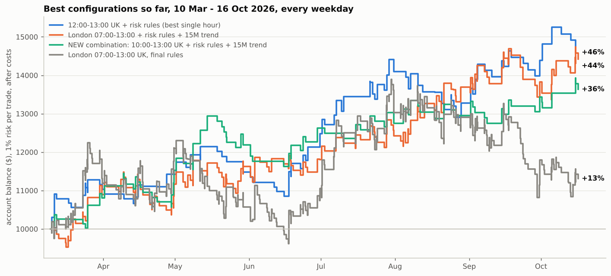

# Best return so far

Every configuration tested in this analysis, re-run on one common basis (`pipeline/compare_results.py`,
`results/best_return_comparison.csv`):

- 10 March – 16 October 2026, **every weekday** (not only the days the journal was kept)
- **1.5 index points** of costs per round trip
- **1% of the balance risked per trade**, compounding from $10,000
- entries in the stated window, all positions flat by 14:30 UK

"Risk rules" are the trader's own: 2 losses = done for the day, SL < 50 pts, BE at +2R, TP at 3R.

| Configuration | Trades | Return | Per month | Max drawdown | Losing months | Sep–Oct |
|---|---|---|---|---|---|---|
| 12:00–13:00 UK + risk rules (best single hour) | 101 | +45.9% | +5.4% | 10.6% | 1 of 8 | +9.9% |
| **London 07:00–13:00 + risk rules + 15M trend** | **189** | **+44.2%** | **+5.2%** | **9.7%** | **0 of 8** | **+5.3%** |
| 10:00–13:00 UK + risk rules + 15M trend (new combination) | 93 | +36.3% | +4.4% | 10.2% | 0 of 8 | +5.3% |
| 10:00–13:00 UK + risk rules (the one-month test setup) | 195 | +30.2% | +3.7% | 17.9% | 3 of 8 | −2.2% |
| London 07:00–13:00 + risk rules + 15M trend + OB/FVG | 162 | +14.2% | +1.9% | 10.8% | 3 of 8 | −4.3% |
| London 07:00–13:00, final rules only | 413 | +13.1% | +1.7% | 22.1% | 4 of 8 | −12.4% |
| London 07:00–13:00 + risk rules + 1H trend | 205 | +11.3% | +1.5% | 15.1% | 4 of 8 | −1.7% |
| London 07:00–13:00 + risk rules + OB/FVG | 292 | +9.1% | +1.2% | 17.3% | 4 of 8 | −10.0% |
| London 07:00–13:00 + risk rules | 334 | +2.7% | +0.4% | 19.4% | 4 of 8 | −12.9% |
| Journal's own window 07:00–14:30 UK, final rules | 534 | −17.3% | −2.6% | 38.8% | 4 of 8 | −24.3% |

Month by month for the leaders (`results/best_return_monthly.csv`):

| | Mar | Apr | May | Jun | Jul | Aug | Sep | Oct |
|---|---|---|---|---|---|---|---|---|
| 12:00–13:00 + risk rules | +10.3% | +3.6% | +0.5% | +8.7% | +12.9% | −5.9% | +8.4% | +1.4% |
| **07:00–13:00 + risk rules + 15M trend** | **+8.9%** | **+2.6%** | **+4.1%** | **+1.5%** | **+5.2%** | **+10.2%** | **+1.0%** | **+4.3%** |
| 10:00–13:00 + risk rules + 15M trend | +8.1% | +6.6% | +5.7% | +3.6% | +0.9% | +1.6% | +3.8% | +1.4% |
| 07:00–13:00, final rules only | +11.9% | +8.2% | −12.6% | +4.6% | +17.8% | −0.9% | −8.6% | −4.2% |

> **Update:** `RR_IMPROVEMENTS.md` builds on this configuration. Skipping spiky impulse legs and
> taking profit at 4R raises it to +96% over the same months (+0.55R per trade, 8.5% max drawdown).

## The answer

**Best so far: the London session (07:00–13:00 UK) with your risk rules and a 15-minute trend filter.**
+44% over the seven months (about +5% a month at 1% risk), the smallest drawdown of any configuration
(9.7%) and not one losing month.

The single hour 12:00–13:00 UK finishes marginally higher (+46%), but it is the weaker choice:

- **It was picked using the same data**: it was the best of 21 windows over all seven months, so its
  result is flattered by the choice itself.
- It had a losing month (−5.9% in August) and rests on only 101 trades.

The 15M-trend setup is built only from your own checklist: your London window, your risk rules and
your "trade aligned with the overall trend" item. Nothing in it was tuned to maximise returns. The
15M EMA50 was chosen as the trend measure because it best matched your own "aligned: Y/N" tags.

**The trend filter, exactly.** Read the last closed 15-minute candle and the 50-period EMA:

- **Longs only** when price is above the EMA50 and the EMA50 is higher than 4 candles ago.
- **Shorts only** when price is below the EMA50 and the EMA50 is lower than 4 candles ago.
- **No trade** when the two disagree.

The trend filter and your risk rules each matter. Without them the same London window makes +13%
(rules only) or +3% (risk rules only); together they make +44%.

## How much to trust it

- **Not proven yet.** The average result is +0.21R per trade after costs, but the 95% range runs from
  −0.05R to +0.48R, so a zero edge cannot be ruled out with seven months of data.
- **One market.** The sample is seven months of a strongly rising Nasdaq, on CFD prices with an assumed
  cost of 1.5 points per trade.
- **Still far below the journal.** Your journal scores +2.0R per trade over the same months
  (3R / 0 / −1R); the best mechanical version scores +0.21R.
- **Next step:** forward-test this exact configuration for two to three months, logging each trade
  before its outcome is known, and compare it with the journal.
