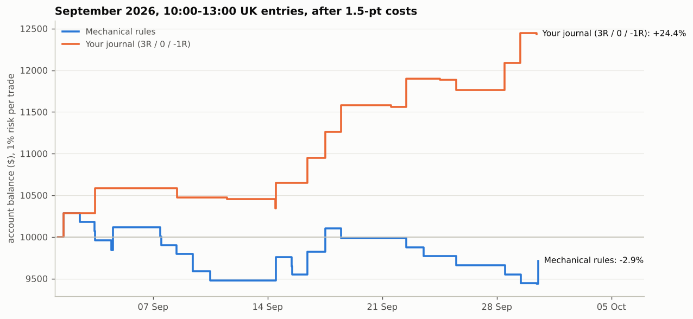

# One-month backtest and the TradingAgents question

## 1. One month under forex-style trading rules

`pipeline/one_month.py` trades the reconstructed strategy (`STRATEGY.md`) the way a forex/CFD account
would be run:

- **Session window of a few hours**, chosen on March–August only, so the test month is unseen.
- **1% of the current balance risked per trade**, sized from the stop (CFD-style, no whole-contract
  rounding), compounding, starting from $10,000.
- **Costs of 1.5 index points per round trip** (NAS100 spread + commission during London hours).
- **Your risk rules:** 2 losses = done for the day, SL < 50 pts, break-even at +2R, take profit at 3R.
- **Flat by 14:30 UK**, the New York open.

**Window choice** (10 Mar – 31 Aug, net of costs):

| 3-hour window (UK) | Trades | Net R per trade | Net R |
|---|---|---|---|
| 07:00–10:00 | 159 | −0.03 | −4.0 |
| 08:00–11:00 | 161 | −0.02 | −3.4 |
| 09:00–12:00 | 157 | +0.06 | +8.9 |
| **10:00–13:00** | **158** | **+0.20** | **+31.2** |

**Test month: September 2026** (the latest full month in the data):

| | Trades | Wins / BE / losses | Net R | Return | Max drawdown | Profit factor |
|---|---|---|---|---|---|---|
| **Strategy, 10:00–13:00 UK** | **25** | **6 / 1 / 18** | **−2.6R** | **−2.9%** | **8.2%** | **0.87** |
| Strategy, whole London session 07:00–13:00 UK | 43 | 10 / 2 / 31 | −5.6R | −6.0% | 16.3% | 0.84 |
| Your journal, 10:00–13:00 UK (3R / 0 / −1R, same costs) | 16 | 9 / 4 / 3 | +22.2R | +24.4% | 2.3% | 6.91 |
| Your journal, 07:00–13:00 UK | 35 | 18 / 8 / 9 | +41.4R | +50.1% | 2.2% | 4.93 |

With a 3R target and 1R stop, the strategy breaks even at a win rate of about 27% after costs.
September came in at 24%: 18 of 25 trades were stopped out. Trade list: `results/one_month_trades.csv`.

**The same rules in every month** (Mar–Aug picked the window, so only Sep and Oct are out of sample):

| Month | Mar | Apr | May | Jun | Jul | Aug | **Sep** | **Oct (to 16th)** |
|---|---|---|---|---|---|---|---|---|
| Trades | 24 | 30 | 27 | 27 | 25 | 25 | 25 | 12 |
| Return | +8.0% | +16.4% | −3.5% | +4.0% | +8.9% | −3.0% | **−2.9%** | **+0.7%** |

Over the whole sample the rules made +30% (about +3.7% a month), but most of that comes from months
that were used to pick the window. On the two months that were not, the result is roughly flat.
One month (25 trades) is too few to judge a strategy either way: with a 3R target and a ~27% win
rate, one standard deviation of a 25-trade month is about ±9% at 1% risk.

## 2. Would TradingAgents help?

[TradingAgents](https://github.com/TauricResearch/TradingAgents) (Tauric Research; read at v0.7.1,
commit `c454491`) is a LangGraph framework of LLM agents that imitates a trading firm:

- **Analysts:** market/technical, news, sentiment (StockTwits, Reddit) and fundamentals (SEC filings).
- **Debate:** bull and bear researchers argue the case, then a research manager writes a plan.
- **Decision:** a trader proposes, three risk analysts debate it, and a portfolio manager decides.

It produces **one rating per ticker per day** (Buy, Overweight, Hold, Underweight, Sell), entered at
the next close and scored over **5 trading days**. Its data is daily candles, news, filings, macro
(FRED) and prediction markets. `NAS100`/`US100` map to the Nasdaq-100 index, and forex pairs are
supported. A decision costs roughly 20–30 model calls (four analysts with tool loops, two researchers,
two managers, a trader and three risk analysts). It needs an API key for an LLM provider, and its own
README says results vary run to run and that it is "a research scaffold … not a strategy with a fixed,
replicable return".

**Fit with this strategy:**

| | TradingAgents | Your strategy |
|---|---|---|
| Decision | One rating a day, after the close | Several entries a session, at a fib level |
| Horizon | 5 trading days | ~20 minutes |
| Inputs | Daily prices, news, filings, sentiment | 15-minute swing structure |
| Speed | Minutes per decision | Limit orders that fill within a minute |

It cannot find or time your entries. The only way to plug it in is as a **daily bias set before
London opens**: longs only on Buy/Overweight days, shorts only on Sell/Underweight days, no trades on
Hold days.

**What the return would be.** Its real accuracy on NQ cannot be measured here: no LLM key or news
feeds, and any model trained on data after the test period would already know the answer. So the bias
was simulated at a given daily accuracy (how often its call matches that day's direction), and the
backtest was re-run with the filter inside it (`pipeline/agent_overlay.py`,
`results/agent_overlay_scenarios.csv`). Strategy: 10:00–13:00 UK with the forex rules above.

| Daily bias | Mar–Oct return (range, 5th–95th pct) | Per month | Trades | Sep 2026 |
|---|---|---|---|---|
| None (strategy alone) | +30.2% | +3.7% | 195 | −2.9% |
| Coin flip (50% accurate) | +20.6% (−3% to +45%) | +2.5% | 104 | −1.2% |
| 55% accurate | +23.4% (+2% to +51%) | +2.8% | 102 | −1.2% |
| 60% accurate | +25.2% (+1% to +53%) | +3.1% | 101 | −1.4% |
| 70% accurate | +31.6% (+8% to +58%) | +3.8% | 98 | −1.4% |
| 55% accurate, Hold on 25% of days | +17.4% (−4% to +40%) | +2.1% | 77 | −0.7% |
| Perfect (impossible upper bound) | +54.0% | +6.1% | 90 | −1.4% |

- The day's direction does matter: trades with it earn +0.43R net, trades against it −0.05R
  (82 vs 113 trades, Mar–Oct).
- But the filter throws away about half the trades. Below ~70% daily accuracy it **lowers** the total
  return; even a perfect daily call would have lifted the seven months from +30% to +54% and would
  still have lost money in September.
- Calling the day's direction on an index 70% of the time is far beyond what daily forecasts usually
  manage, and TradingAgents publishes no such figure for NQ.

**Verdict: not as a trade filter.** On the evidence it would most likely cut returns while adding cost
(about 400–650 model calls a month) and run-to-run randomness. If you want to test it, run it in
shadow mode for two to three months: record its call each morning before 07:00 UK, don't act on it,
and only switch it on if it calls NQ's day correctly more than ~70% of the time.

Its most useful idea for you is its **memory log**: every decision is written down *before* the
outcome is known and settled automatically afterwards. That is the forward test this journal still
needs, because the journal's +24% month sits next to the rules' −3% on the same days.
