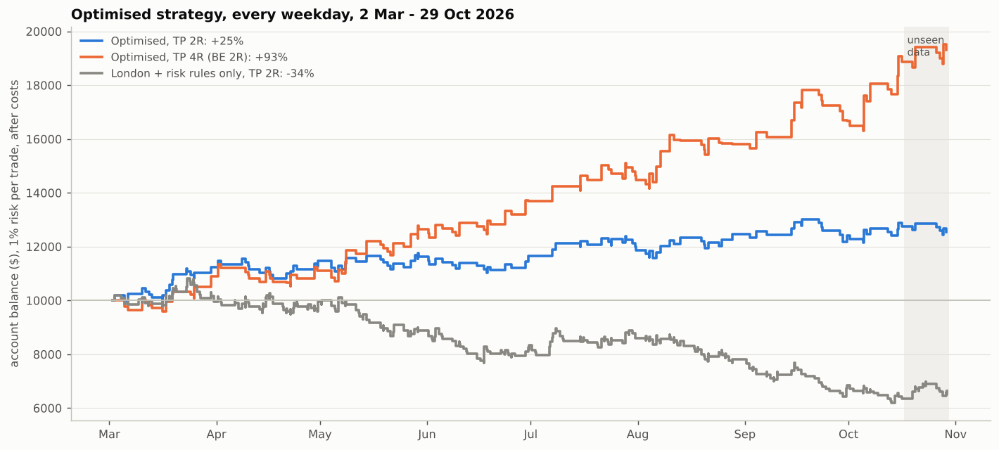

# Optimised strategy: TP 2R vs TP 4R, 2 March – 29 October 2026

A pure price backtest on Dukascopy Nasdaq-100 data, with no journal input of any kind: every
weekday from 2 March to 29 October 2026 is traded mechanically (`pipeline/optimised_backtest.py`,
`results/optimised_backtest.csv`).

- **Session:** entries 07:00–13:00 UK, everything flat by 14:30 UK.
- **Setup:** the most recent unbroken 15-minute swing leg (at least 2 × ATR), with a limit order at
  its untouched 0.705 or 0.79 retracement; stop 14% of the leg beyond the entry.
- **Your risk rules:** 2 losses = done for the day, SL < 50 pts.
- **Account:** 1% of the balance risked per trade, compounding from $10,000, after 1.5 points of
  costs per trade.
- **Unseen data:** 17–29 October was never used to choose anything and is reported separately.

## The additions, one at a time

| Additions | TP 2R: trades | Win rate (needed) | R / trade | Return | Max drawdown | TP 4R (BE 2R): R / trade | Return | Max drawdown |
|---|---|---|---|---|---|---|---|---|
| 1. London 07:00–13:00 + your risk rules | 370 | 33% (37%) | −0.10 | −34% | 42.7% | +0.12 | +39% | 18.4% |
| 2. + 15M trend filter | 209 | 36% (37%) | −0.03 | −9% | 16.9% | +0.22 | +51% | 11.9% |
| **3. + skip spiky legs = optimised** | **141** | **43% (37%)** | **+0.17** | **+25%** | **6.7%** | **+0.50** | **+93%** | **8.5%** |
| 4. optimised + stop 0.17 × leg | 141 | 45% (36%) | +0.28 | +45% | 6.3% | +0.53 | +101% | 7.3% |
| 5. optimised + wick-heavy pullbacks only | 71 | 51% (37%) | +0.41 | +33% | 4.6% | +0.70 | +61% | 4.5% |

"Needed" is the win rate at which TP 2R breaks even after costs (about 37%; about 22% for TP 4R).

- **At 2R the additions are what make it work.** Without them the setup wins 33% of the time when
  2R needs 37%, and loses a third of the account. The trend filter gets it to break-even; **skipping
  spiky legs is what turns it profitable**, lifting the win rate to 43%.
- **Moving the stop to break-even at 1R hurts in every row** (e.g. optimised: +14% instead of +25%).
  At a 2R target, let the trade run to its stop or its target.
- **The best 2R version adds the 0.17 stop**: 45% winners, +45%, 6.3% maximum drawdown.

## TP 2R vs TP 4R on the optimised strategy

| | TP 2R | TP 4R (BE at 2R) |
|---|---|---|
| Trades (per month) | 141 (17.8) | 140 (17.7) |
| Winners / scratched at BE / losers | 43% / 0% / 57% | 29% / 14% / 57% |
| Net R per trade | +0.17 | +0.50 |
| Profit factor | 1.27 | 1.77 |
| Return, 2 Mar – 29 Oct | **+25%** (≈ +2.9% a month) | **+93%** (≈ +8.7% a month) |
| Max drawdown | 6.7% | 8.5% |
| Longest losing streak | 6 | 6 |
| Losing months | 1 of 8 (Sep −0.5%) | 0 of 8 |
| Unseen 17–29 Oct (7 trades) | −1.6% | +2.3% |

Return by month (%):

| | Mar | Apr | May | Jun | Jul | Aug | Sep | Oct |
|---|---|---|---|---|---|---|---|---|
| TP 2R | +12.5 | +2.0 | +1.3 | +0.3 | +1.7 | +5.2 | −0.5 | +1.0 |
| TP 4R | +9.1 | +1.8 | +13.8 | +8.4 | +5.6 | +9.2 | +5.4 | +15.8 |

- **Both targets take almost the same trades** (141 vs 140), and the same 43% of them reach 2R. The
  2R target banks those; TP 4R lets them run: 29% go on to 4R, and 14% stall and come back to
  break-even.
- **TP 4R earns about three times as much** for a slightly larger drawdown (8.5% vs 6.7%) and the
  same longest losing streak. It also had no losing month.
- **TP 2R is steadier but thin:** after March, most months add only 0–2%, and its edge over the
  37% break-even win rate is just 6 percentage points.
- **The unseen fortnight** was 2 wins and 5 losses under both targets. Two 2R wins (+3.8R after
  costs) don't cover five losses (−5.4R), so 2R finished −1.6%; two 4R wins (+7.8R) do, so 4R finished
  +2.3%. Seven trades say nothing either way about the strategy.

Trade lists: `results/optimised_trades_tp2r.csv`, `results/optimised_trades_tp4r.csv`.

## Verdict

- **For return: TP 4R.** +93% over eight months at 1% risk, 8.5% maximum drawdown, every month positive.
- **If you prefer a 2R target:** use the optimised strategy with the 0.17 stop (+45%, 45% winners,
  6.3% drawdown), and don't move to break-even at 1R. Without the spiky-leg filter, a 2R target
  loses money.

## How much to trust it

- **No journal input**, but the additions (trend filter, spiky-leg filter, stop size) were chosen on
  data up to 16 October. Only 17–29 October is truly unseen, and it holds 7 trades.
- **Eight months of one market**, on CFD prices with an assumed 1.5-pt cost. Expect lower results live.
- **Next step:** forward-test it, logging each trade before its outcome is known.
