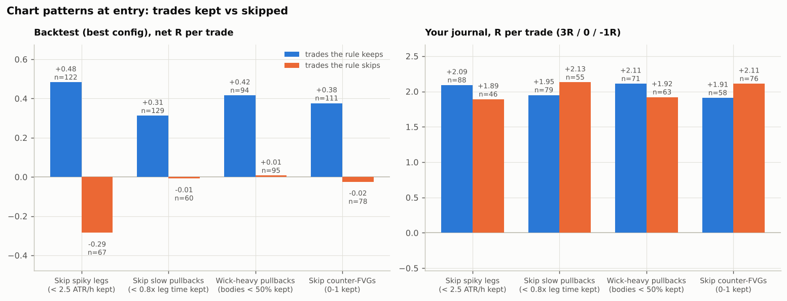
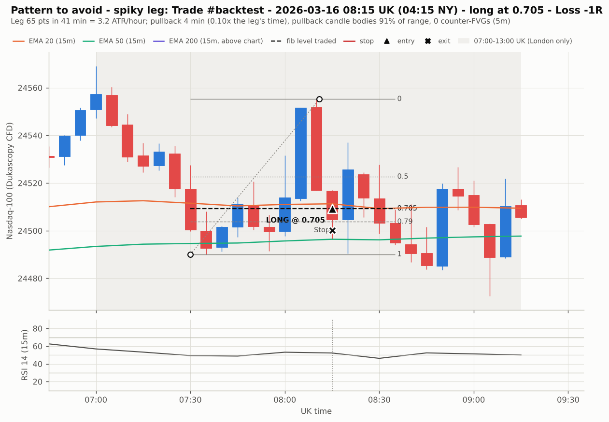
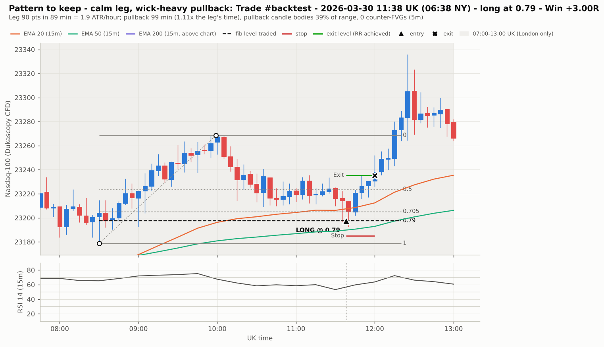

# Raising R per trade

Starting point: the best configuration so far (`BEST_RETURN.md`): London 07:00–13:00 UK, your risk
rules, 15-minute trend filter. 189 trades, **+0.21R per trade**, +44% over 10 Mar – 16 Oct 2026.

How the improvements were found and tested:

1. **Describe each trade's chart at the moment of entry**, from closed candles only
   (`pipeline/trade_features.py`):
   - the impulse leg: speed, biggest candle, FVGs, break of structure, liquidity sweep;
   - the pullback: duration, speed, candle shape, counter-moves;
   - the context: hour, volatility, the day's range so far, 1H trend, OB/FVG at the level,
     premium/discount, stop size.
2. **Look for patterns** that separate winners from losers in March–August, and check them in
   September–October.
3. **Check them against your journal.** Your journal's outcomes don't come from this backtest at all.
4. **Test each change inside the backtest** on the common basis (every weekday, 1.5-pt costs, 1% risk
   compounding), so a skipped trade frees the slot for the next one (`pipeline/improve_rr.py`).
5. **Check each threshold is a plateau**, not a single lucky number.

## Chart patterns

| Pattern | Rule | In the backtest | In your journal | Verdict |
|---|---|---|---|---|
| **Spiky impulse leg** | Skip legs faster than **2.5 × ATR(15M) per hour** (leg size ÷ ATR ÷ hours from swing point to extreme) | 128 trades, **+0.45R** per trade, +73%, drawdown 6.7%; better in both periods; cutoffs of 2.0 and 3.0 also beat the baseline | Trades kept +2.09R, 12.5% losses; trades skipped +1.89R, 19.6% losses | **Adopt** |
| **Wick-heavy pullback** | Only take pullbacks whose 5-minute candles have bodies **< 50% of their range** | 102 trades, +0.38R per trade, +44%; weaker in Sep–Oct | Kept +2.11R, 12.7% losses; skipped +1.92R, 17.5% losses | Optional quality filter |
| Slow, grinding pullback | Skip pullbacks lasting ≥ 0.8× the leg's time | 133 trades, +0.30R | Opposite: kept +1.95R, skipped +2.13R | Not confirmed |
| Counter-FVGs in the pullback | Skip pullbacks with 2+ counter-direction 5m FVGs | 117 trades, +0.37R | Opposite: kept +1.91R, skipped +2.11R | Not confirmed |

What the two confirmed patterns look like:

- **Spiky leg, avoid:** the leg is one or two huge candles, typically a news jerk or a stop run.
  Price snaps back through the fib zone instead of respecting it, and the stop is hit within minutes.
  In the example below the leg covers 65 points in 41 minutes and the pullback takes 4.
- **Calm leg with a wick-heavy pullback, keep:** a steady staircase leg, then a slow pullback of small,
  overlapping, wicky candles. There is no real counter-pressure, and the trend resumes from the fib.

Patterns that turned out to be noise (they flip between the two periods or between the two trade
sets): leg size, the biggest candle in the leg, FVGs inside the leg, break of structure, a liquidity
sweep at the swing point, the leg making a new session high/low, ATR level, how much of the day's usual
range is used, the 1H trend, an OB/FVG at the level, premium/discount vs the 00:00 open, and stop size
in points (`results/pattern_buckets.csv`).

## Trade management

All on the baseline entries (`results/rr_improvements.csv`):

| Change | Trades | R per trade | Return | Max drawdown | Mar–Aug / Sep–Oct |
|---|---|---|---|---|---|
| Baseline: TP 3R, BE at 2R, stop 0.14 × leg | 189 | +0.21 | +44% | 9.7% | +37% / +5% |
| TP 2R or 2.5R (any BE setting) | 189–193 | −0.00 to +0.10 | −2% to +18% | 9–18% | worse |
| **TP 4R, BE at 2R** | 186 | **+0.29** | **+65%** | 11.9% | +45% / +14% |
| TP 5R, BE at 2R | 185 | +0.28 | +61% | 11.7% | +37% / +17% |
| TP 4R, lock +1R at +2R | 189 | +0.18 | +37% | 14.0% | worse |
| Half off at 2R, rest to 4R | 186 | +0.15 | +29% | 10.7% | worse |
| Half off at 3R, rest to 5R | 185 | +0.25 | +52% | 10.7% | +34% / +14% |
| Stop 0.12 × leg | 190 | +0.11 | +19% | 12.1% | worse |
| **Stop 0.17 × leg** | 191 | **+0.33** | **+82%** | 10.3% | +70% / +7% |
| Stop 0.16 / 0.18 / 0.20 × leg | 185–191 | +0.29 to +0.37 | +67% to +97% | 8–10% | all better |
| Enter at 0.79 only | 144 | +0.11 | +14% | 10.1% | worse |

- **Let winners run to 4R.** Every target of 4R or more beats 3R, and every target of 2–2.5R loses
  money. TP 4R is already inside your own "TP 3RR–4RR" rule.
- **Don't lock in profit early.** Locking +1R or taking half off at 2R both cost more than they save.
- **Give the stop a little more room: 0.17 × leg** instead of 0.14 (≈ fib 0.875 for 0.705 entries,
  ≈ 0.96 for 0.79). Every stop from 0.16 to 0.20 does better and 0.12 does worse: a 0.14 stop sits
  inside normal pullback noise.

## Combined

| Combination | Trades | R per trade (95% range) | Return | Max drawdown | Losing months | Mar–Aug / Sep–Oct |
|---|---|---|---|---|---|---|
| Baseline | 189 | +0.21 (−0.03 to +0.49) | +44% | 9.7% | 0 of 8 | +37% / +5% |
| **Skip spiky legs + TP 4R / BE 2R** | **127** | **+0.55 (+0.17 to +0.94)** | **+96%** | **8.5%** | **0 of 8** | **+64% / +19%** |
| Skip spiky legs + stop 0.17 | 129 | +0.55 (+0.22 to +0.88) | +98% | 7.3% | 0 of 8 | +73% / +14% |
| Skip spiky legs + TP 4R + stop 0.17 | 127 | +0.54 (+0.16 to +0.93) | +91% | 7.3% | 0 of 8 | +61% / +19% |
| … + wick-heavy pullbacks only | 62 | **+1.09 (+0.53 to +1.67)** | +92% | **3.5%** | 1 of 8 | +60% / +21% |

**Recommendation: skip spiky legs and take profit at 4R** (BE at 2R as now). This more than doubles
R per trade, from +0.21R to +0.55R, takes the seven-month result from +44% to +96%, keeps drawdown
under 9%, and stays inside your own checklist. Its 95% range (+0.17R to +0.94R per trade) sits
clearly above zero, which the baseline's did not.

The wider stop (0.17) is an equally good alternative to TP 4R, but stacking both adds nothing: the
three changes fix the same problem, getting stopped out by noise. If you prefer fewer, higher-quality
trades, add the wick-heavy pullback filter: R per trade doubles again to about +1.1R, on half as many
trades (about 9 a month), with a 3.5% maximum drawdown and the same total return.

## How much to trust it

- Patterns were picked after looking at both periods, so September–October is not a clean test for
  them. The safeguards are the journal check, the plateau checks and a clear chart logic.
- Seven months of one market. Each extra rule adds selection risk, so expect live results to be
  lower than these.
- The next step is the same as before: forward-test **skip spiky legs + TP 4R** for two to three
  months, logging each trade before its outcome is known.
