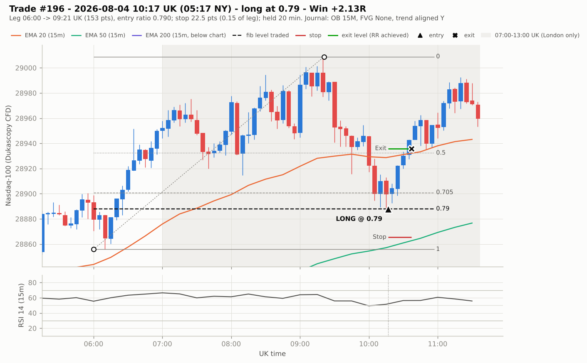

# Model 2 – London: reconstructed strategy rules (NQ)

Reverse-engineered from `Model2_London_Journal_V4.xlsx`: 250 NQ (Nasdaq-100 E-mini) trades,
10 Mar – 16 Oct 2026. The journal records no direction, prices, stops or size, so these were
reconstructed from 1-minute Nasdaq-100 data (Dukascopy CFD, which tracks NQ with 0.9965 5-minute
return correlation). See `VALIDATION.md` for how well the rules reproduce the trades and what they
cannot explain.

**About the times.** The journal's "Session Time (London)" column names the *session*; the times in
it are written on the **New York clock** (like the journal's news times, 8:30 CPI, and its 18:00 /
00:00 key opens). Read as UK clock times, the trades no longer line up with the price data at all
(section 2). Times below are given on both clocks; the UK clock is New York + 5 hours (+4 hours
from 8 to 28 March and from 25 October to 1 November, when only one country is on summer time).

**In one sentence:** during the London session (07:00–13:00 UK), wait for a 15-minute swing leg
to retrace into the 0.705–0.79 zone of its fib, enter there with a limit order, put the stop about
a seventh of the leg beyond the entry (still inside the swing point), move it to break-even at +2R
and take profit at 3R.

Confidence levels: **High** = holds for (nearly) every trade and is clearly not chance.
**Medium** = holds for most trades or is strongly supported but not exact.
**Low** = a tendency only; the trader is likely using judgement that the data cannot see.

## The trader's stated checklist vs this reconstruction

The trader's own "Model 2" checklist was shared after the first version of this analysis. Each item
was checked against the journal and the price data.

| Checklist item | What the data shows | Verdict |
|---|---|---|
| 1% risk per trade | Every full loss is logged as exactly −1R | Consistent (the % itself cannot be seen) |
| 2 losses = done for the day | 4 days had 2 losses; on one (29 Sep) two more trades were taken afterwards | Followed on 3 of 4 days |
| BE at 2RR | 31 of 33 "BE" trades reached 2R, then came back to the entry before 3R; every loser but one peaked below 1.8R | Confirmed — and it corrects this analysis: "BE" trades are 0R scratches, not profits |
| TP at 3RR–4RR | Every "Win" reached ≥2.98R (the Stats sheet's own definition). But the "RR Achieved" column logs 51% of wins below 3R | TP 3R matches the Win/BE/Loss classes; "RR Achieved" does not record a 3–4R exit |
| SL < 50pts | Largest losing stop 47.5 pts; 6 of 213 inferred stops exceed 50 (likely inference error) | Consistent |
| 15M fib from swing point to swing point | Confirmed; this analysis adds *which* swing: the most recent unbroken 2-bar fractal, leg ≥1.5–2 ATR (section 3) | Confirmed, made specific |
| Either a HTF OB/FVG | Logged on 95% of trades; detected at the entry on 74%; loss rate no lower when present | Present, but not what separates winners |
| Key open level | Logged on only 24% of trades (accurately — 86% of those entries are within 1R of the 00:00/18:00 open) | Optional in practice; no better results when present |
| Trade aligned with the overall trend | Logged Y on 83%. "Y" trades agree with the 15M EMA50 trend 62% of the time, "N" trades only 10% | Partly reproducible as a short-term (15M/1H) trend read |

Scored the way the checklist implies (Win = +3R, BE = 0R, Loss = −1R), the journal averages
**+1.94R per trade**, not the +2.54R that the "RR Achieved" column adds up to.

Not on the checklist but found in the trades: the session window, the exact swing definition,
entries only at an untouched 0.705/0.79 level, and a stop of ~14% of the leg (well inside the 50-pt cap).

---

## 1. Market and timeframes — *High*

1. Instrument: **NQ** (Nasdaq-100 futures). All 250 trades.
2. Structure timeframe: **15-minute** chart. The journal's own checklist says
   "Fib 15M drawn = Y" on every trade, and the reconstructed legs confirm it (section 3).
3. Confluence timeframes: 15M, 30M and 1H order blocks / fair value gaps (journal tags).
4. Execution: intraday limit orders; trades last minutes (median 21 min, 90% under 70 min).

## 2. Session window — London only — *High (timing) / Medium (London-only improvement)*

5. Only place entries **between 07:00 and 13:00 UK time** (02:00–08:00 New York): London open until
   the New York session starts. No other sessions.
   - The journal's entries run from 02:00 to 09:22 New York = **07:00 to 14:22 UK**, spread evenly
     across the hours. 203 of the 250 trades fall in 07:00–13:00 UK; 43 were taken 13:00–14:30 UK
     (the New York pre-open, including entries at the 08:30 New York data releases) and 4 just
     before 07:00 UK in March, when the UK was only 4 hours ahead.
   - That last stretch was the weakest in both the journal (+1.67R per trade, scored 3R / 0 / −1R,
     vs about +2.0R in London) and the backtest (−0.09R per trade vs +0.04R to +0.34R in London).
     Dropping it lifts the mechanical rules from +0.09R to **+0.21R per trade** (95% range +0.02 to
     +0.40R; 6 of 8 months positive) — a real but small, same-sample improvement.
   - Within London, the 07:00–10:00 UK kill zone and 10:00–13:00 UK did about equally well in the
     journal (+1.99R and +2.01R per trade). `results/london_session_windows.csv`

*Evidence that the logged times are New York clock time* (`results/timezone_reading_check.csv`):

| Logged times read as… | Trades the price path explains | Entries on the logged fib of the latest leg (chance) | Journal trades the backtest reproduces |
|---|---|---|---|
| **New York clock** | **94%** | **69%** (11%) | **57%** |
| UK clock | 56% | 9% (5%) | 8% |
| UTC / Central Europe / South Africa | 54–56% | 5–7% (5–16%) | 7–9% |

Read as UK clock times, 82% of the entries would fall before the 08:00 London open (02:00–09:22 UK
is mostly the Asian session), and the fib-level match drops to chance.

## 3. Define the fib leg — *Medium–High*

6. Mark 15M swing points as **2-bar fractals** (a candle whose high/low is the extreme of the two
   candles either side). A swing is only usable once the two candles after it have closed.
7. For a **long**: take the **most recent 15M swing low that price has not traded below**, and the
   **highest high made since it**. Draw the fib from that swing low (1.0) to that high (0.0).
   For a **short**: mirror image — most recent unbroken 15M swing high to the lowest low since.
8. Ignore legs smaller than **~1.5–2 × ATR(14) on 15M**. (Typical leg: 119 pts, 3.4 ATR,
   82 minutes from swing to extreme; entries come a median 63 minutes after the extreme.)
9. Legs usually start in the overnight/Asian session (44%) or 07:00–10:00 UK (31%); the extreme is
   usually printed 07:00–10:00 UK (42%) or 10:00–14:00 UK (36%).

*Evidence:* using only the entry price implied by the price path, the logged fib level (0.705 or
0.79, ±0.05) lands on this exact leg for **77% of trades** with a known direction (69% if only
counting trades whose direction was identified without using the fib). The same test at random
minutes of the same sessions hits 11% — a 7× lift. Weaker (1-bar) or stronger (3-bar) fractals and
larger size filters all fit worse (`results/leg_definition_test.csv`).

## 4. Direction — *High (that there is no bias) / Low (for the trader's trend read)*

10. Trade **with the leg**: buy retracements of up-legs, sell retracements of down-legs.
    The sample is evenly split: 108 longs, 105 shorts, with near-identical loss rates (12.0% vs 12.4%).
11. **Trend is a short-term, discretionary read — not a moving-average rule.** Across all trades,
    price vs EMA 20/50/200 on 15M, 1H, 4H or daily agrees with the trade direction only 46–57% of
    the time. The trader's own "aligned with trend" tag (83% Y) lines up best with the 15M EMA50
    trend: 62% of "Y" trades vs 10% of "N" trades. As a mechanical filter it halves the number of
    trades and only nudges expectancy (see `VALIDATION.md`). *Low–Medium.*

## 5. Setup filters

12. **The level must be fresh** — price has not already touched it since the leg's extreme. *Medium.*
    Generated setups where the level was already touched were taken by the trader half as often
    (12% vs 25%).
13. **Order block / FVG confluence at the entry level.** *Medium (present, but not selective).*
    The journal logs an OB or FVG on 95% of trades; independent detection finds a 15M/30M/1H OB or FVG
    covering the entry price on 74% — but losers have one just as often as winners, so it does not
    separate good from bad trades. A **key open** (00:00 / 18:00) near the entry is logged on only
    24% of trades, with no better results, so it is optional confluence.
14. Not part of the rules (each holds for roughly 35–62% of trades and does not separate winners
    from losers): RSI, MACD, Stochastic and Bollinger Band position; premium/discount versus the
    00:00 or 18:00 open; sweeps of the Asian or previous-day high/low.
15. Break of structure describes the typical leg (79% of legs took out the previous opposite 15M
    swing) but adds nothing as a filter: requiring it lowered the match with the journal without
    improving precision. *Low.* (`results/condition_prevalence.csv`, `results/sensitivity_grid.csv`)

## 6. Entry — *Medium*

16. Rest a **limit order at the 0.79** level (61% of trades) **or the 0.705** level (39%).
17. Which level: 0.705 entries more often have a **15M fair value gap** at the level (38% vs 17%),
    0.79 entries more often a **15M order block** (43% vs 29%); the journal's own tags agree.
    *Low confidence* — as a mechanical rule this choice was right only about half the time.
18. One position at a time; each leg is traded once. 1–5 trades a day (55 days with 1, 43 with 2,
    25 with 3, 8 with 4–5).

## 7. Stop loss — *Medium–High*

19. Place the stop **about 14% of the leg beyond the entry** — i.e. at roughly fib **0.84 for a 0.705
    entry** and **0.93 for a 0.79 entry**. The stop always stays inside the swing point (1.0).
20. In points this is a median 18.6 pts (IQR 12–25); it is *not* a fixed point stop or an ATR stop.
    The trader's cap of **SL < 50 pts** holds: the widest losing stop was 47.5 pts.

*Evidence:* the stop implied for losers (stop = MAE), winners and the "BE" class independently
comes out at 0.152, 0.141 and 0.141 of the leg. As a fraction of the leg the stop varies far less
(coefficient of variation 0.23) than in points (0.51) or ATR multiples (0.43).

## 8. Take profit and trade management — *High (BE at 2R) / Medium (TP 3R)*

21. **Move the stop to break-even at +2R.** Every loser but one peaked below 1.8R (trade 71, which
    ran +9.8R first, is the exception), and 31 of the 33 "BE" trades reached 2R and then came back
    to the entry before 3R. The journal's "BE" trades are therefore **0R scratches**; their
    "RR Achieved" (1.7–2.9) is how far they ran, not what was banked.
22. **Take profit at 3R** (the checklist says 3–4R). Every "Win" reached at least 2.98R, which is the
    Stats sheet's definition of a win. On the fib, 3R from a 0.705/0.79 entry with a 0.14-leg stop lands
    around the 0.3–0.4 retracement, **before** the leg's extreme.
23. The "RR Achieved" column does not record a 3–4R exit: it logs 51% of wins between 2.0R and 3R
    and 24% above 4R (median 3.1R). Read it as the R at the logged time, not as the exit rule.
    Scored as TP 3R / BE 0R / SL −1R, the journal averages +1.94R per trade.
24. Trades are short: median 23 min for winners, 15 min for losers; all but one were closed by
    15:00 UK (10:00 New York; the latest exit was 15:14 UK).

## 9. Position sizing and daily risk — *High (stated by the trader, consistent with the journal)*

25. **Risk 1% of the account per trade**: every full loss is recorded as exactly −1R.
    Contracts = (1% of account) ÷ (stop in points × $20 per point for NQ, or $2 for MNQ).
26. **Stop for the day after 2 losses.** Followed on 3 of the 4 days that had two losses
    (on 29 Sep two more trades followed).

## 10. When not to trade — *High for the window, Low for anything else*

27. No entries before 07:00 or after 13:00 UK (02:00 / 08:00 New York) — London only. The journal
    itself ran to 14:22 UK (09:22 New York); see section 2.
28. The trader did **not** avoid news: 40% of trades were on days with high-impact US data,
    including entries right at the 08:30 New York (13:30 UK) CPI release, and the loss rate on news
    days was no worse (10% vs 14%). Under the London-only window the 08:30 New York releases fall
    after the cut-off; 10:00 and 14:00 New York releases are after it anyway.
29. No trades on US market holidays (Good Friday, Memorial Day, 3 Jul, Labor Day) and none logged
    19–31 Aug.

---

## Example: a typical trade

Trade #196 (4 Aug 2026, chart on the UK clock). The 15M swing low at 06:00 UK (1.0) and the high at
09:21 UK (0.0) define a 153-point leg (3.5 × ATR). Price retraces through 0.705 and fills the long at
the untouched 0.79 level at 10:17 UK (05:17 New York, as logged); the stop sits 22.5 pts below (0.15 of the leg, fib ≈ 0.94). The journal logs
+2.1R twenty minutes later, around the 0.5 retracement; the trade went on to reach 3R (a "Win").

More charts (one win each way, a loss, a "BE", and a trade the rules do **not** explain):
`charts/trade_246_short_win.png`, `charts/trade_167_loss.png`,
`charts/trade_061_be_at_2R.png`, `charts/trade_010_does_not_fit.png`.

## Trades that do not fit

- **37 trades (15%)** — direction could not be identified from the price path (16 fit neither
  direction, 21 fit both). Possible causes: CFD-vs-futures wick differences on very short trades,
  or journal values entered loosely.
- **50 of the 213 trades with a direction (23%)** do not sit at the logged fib of the most recent leg.
  Most are either entries beyond a small recent swing (the trader used a bigger leg) or entries on
  a smaller, newer swing than a 2-bar fractal picks up (e.g. trade #10, entry at 0.43 of the leg).
- Two journal oddities: trade 9 is a "Loss" of −0.01R, and trade 71 is a −1R loss that had run +9.8R.

## Summary of confidence

| Section | Rule | Confidence | Main evidence |
|---|------|-----------|---------------|
| 1 | NQ, 15M structure | High | 250/250 trades; journal checklist |
| 2 | London only: entries 07:00–13:00 UK | High (timing) / Medium (London-only edge) | times are New York clock (fit 94% vs ≤56% for UK clock); London-only lifts the backtest from +0.09R to +0.21R per trade |
| 3 | Leg = most recent unbroken 15M fractal → extreme, ≥1.5–2 ATR | Medium–High | 77% match vs 11% chance |
| 4 | Trade with the leg; trend is a short-term discretionary read | High (no bias) / Low–Medium (trend) | 108 L / 105 S; 15M EMA50 agrees with 62% of "Y" vs 10% of "N" trades |
| 5 | Fresh (untouched) level; OB/FVG present, key open optional | Medium | 2× higher take-rate in backtest; OB/FVG 95% logged, key open 24% |
| 6 | Limit at 0.79 or 0.705 | Medium (level) / Low (which one) | 61% / 39%; FVG vs OB tendency |
| 7 | Stop ≈ 0.14 × leg beyond entry, < 50 pts | Medium–High | 0.141–0.152 in all three outcome groups; max loss stop 47.5 pts |
| 8 | Break-even at +2R | High | 31/33 "BE" trades hit 2R then entry; loser MFE ≤1.77R (one exception) |
| 8b | Take profit at 3R | Medium | every Win reached ≥2.98R; "RR Achieved" disagrees for half the wins |
| 9 | 1% risk per trade, done after 2 losses | High | all full losses = −1R; 3 of 4 two-loss days stopped |
| 10 | No news avoidance | High | 40% of trades on news days |
