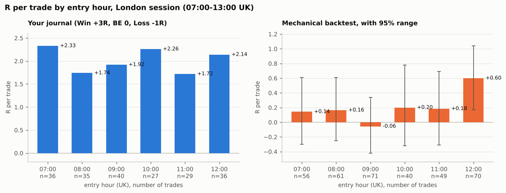

# How well the reconstructed strategy matches the journal

`replicate_strategy.py` codes the rules from `STRATEGY.md` and runs them minute by minute over
10 Mar – 16 Oct 2026 on 1-minute data, trading the **London session only: 07:00–13:00 UK**.
It is compared with the 203 journal trades taken in that window (the journal's other 47 trades
were 13:00–14:30 UK or, in March, just before 07:00 UK). A generated trade **matches** a journal
trade when it is on the same day, in the same direction (where the direction is known), and enters
within ±15 minutes. Precision is measured on the 131 days the trader logged trades; trades generated
on the 28 weekdays with no journal entries (holidays and a late-August gap) are reported separately.

All variants exit the way the trader's checklist says: **stop to break-even at +2R, take profit at 3R**.

## Result

| Round | Rules | Generated | Matched (recall) | Precision | Extra trades |
|---|---|---|---|---|---|
| Baseline | 0.79 limit on the most recent 15M leg ≥1.5 ATR; stop 0.14 × leg | 496 | 108 (53%) | 22% | 388 (+112 on unlogged days) |
| Refine 1 | + level must be untouched since the extreme; leg ≥2 ATR | 286 | 91 (45%) | 32% | 195 (+59) |
| **Refine 2 (final)** | + orders at both 0.705 and 0.79, first untouched level fills | **347** | **116 (57%)** | **33%** | **231 (+66)** |

- **Entries:** the final rules reproduce **116 of the 203 London journal trades (57%)**, at a median
  timing difference of 0 minutes; 90% of matches use the same swing anchor as the trader. They pick
  the same fib level only 54% of the time, so *which* of 0.705/0.79 the trader chooses is not captured.
- **Missed (87):**
  - 21 have no inferred direction.
  - 38 sit on the right fib level but were filtered out (leg too small, level already touched) or
    blocked by an open position.
  - 28 do not sit at the fib of the most recent leg.
- **Extra trades:** about 1.8 a day more than the trader took. The trader is far more selective
  than any rule found here.
- Tested and dropped: requiring a break of structure, and choosing the level by FVG/OB location.
  A 36-combination sensitivity grid (`results/sensitivity_grid.csv`) is fairly flat (F1 0.31–0.42)
  and the final rules come out on top, so they are not a lucky corner of the parameter space.

## The trader's own checklist, coded

Each checklist item added on top of the final rules:

| Variant | Generated | Matched (recall) | Precision | Mechanical R / trade |
|---|---|---|---|---|
| Final rules | 347 | 116 (57%) | 33% | +0.21 |
| + 2 losses = done for the day, SL < 50 pts | 279 | 100 (49%) | 36% | +0.19 |
| + trend aligned (15M EMA50 trend) | 166 | 59 (29%) | 36% | +0.37 |
| + trend aligned (1H EMA50 trend) | 177 | 60 (30%) | 34% | +0.27 |
| + HTF OB/FVG at the entry (15M/30M/1H) | 246 | 88 (43%) | 36% | +0.23 |
| + 15M trend and OB/FVG | 144 | 51 (25%) | 35% | +0.28 |

The checklist items make the rules slightly more selective, and the 15M trend filter has the best
expectancy (+0.37R), but on far fewer trades and with the mechanical loss rate still at ~62%. The
2-loss daily stop costs recall because the mechanical rules lose earlier in the day than the trader
did, so they stop before reaching the trader's later trades. "Key open level" was not coded: the
trader logged it on only 24% of trades.

## Time zone and London-only trading

The journal's "Session Time (London)" column was re-read in five time zones and the whole chain
repeated each time (`pipeline/london_time_check.py`, `results/timezone_reading_check.csv`):

| Logged times read as… | Entries (UK clock) | Price path explains | Fib match (chance) | Backtest recall / precision |
|---|---|---|---|---|
| **New York clock** | 07:00–14:22 | **94%** | **69%** (11%) | **57% / 32%** |
| UK clock | 02:00–09:22 | 56% | 9% (5%) | 8% / 6% |
| UTC | 02:06–10:22 | 56% | 7% (7%) | 9% / 7% |
| Central Europe | 01:00–08:22 | 54% | 5% (16%) | 7% / 5% |
| South Africa | 00:06–08:22 | 54% | 6% (5%) | 7% / 5% |

Only the New York reading fits; under any other, the entries stop sitting on the fib levels the
trader logged. Read on the New York clock, the trades are London-session trades (07:00–14:22 UK).

The journal's own window versus London only (`results/london_session_windows.csv`; journal scored
3R / 0 / −1R):

| Window | Journal trades | Journal R / trade | Backtest trades | Backtest recall | Backtest R / trade |
|---|---|---|---|---|---|
| 07:00–10:00 UK (London kill zone) | 111 | +1.99 | 187 | 59% | +0.04 |
| 10:00–13:00 UK | 93 | +2.01 | 187 | 62% | +0.34 |
| 13:00–14:30 UK (NY pre-open, 08:30 NY news) | 46 | +1.67 | 155 | 76% | −0.09 |
| As journaled (07:00–14:30 UK) | 250 | +1.94 | 447 | 57% | +0.09 |
| **London only (07:00–13:00 UK clock)** | **203** | **+2.02** | **347** | **57%** | **+0.21** |

The first four rows use the New York-clock windows the journal was logged on (UK = New York + 5h;
+4h from 8 to 28 March) and test each window on its own; the last row is the rule, set on the UK clock.
The 13:00–14:30 UK stretch is the weakest in both the journal and the backtest; dropping it raises
the mechanical result from +0.09R to +0.21R per trade (95% range +0.02R to +0.40R, positive in
6 of 8 months).

## Best return window inside London

`pipeline/best_window.py` scores every hour and every block of 2–6 consecutive hours between 07:00
and 13:00 UK (`results/london_window_returns.csv`, `charts/london_hours.png`). The backtest column
buckets the final rules' trades by entry time; trades may run until the New York open.

| Window (UK) | Journal trades | Journal R / trade | Backtest trades | Backtest R / trade (95% range) | Backtest total R | Max drawdown | 1st / 2nd half |
|---|---|---|---|---|---|---|---|
| 07:00–10:00 | 111 | +2.00 | 188 | +0.07 (−0.16 to +0.32) | +14 | 23R | +0.00 / +0.15 |
| **10:00–13:00** | 92 | +2.04 | **159** | **+0.37 (+0.08 to +0.65)** | **+59** | 16R | +0.41 / +0.31 |
| 12:00–13:00 (best hour) | 36 | +2.14 | 70 | +0.60 (+0.13 to +1.04) | +42 | 8R | +0.54 / +0.66 |
| 07:00–13:00 (whole session) | 203 | +2.02 | 347 | +0.21 (+0.02 to +0.40) | +73 | 18R | +0.20 / +0.22 |

- **Mechanically, the late London morning carries the edge.** 10:00–13:00 UK earns +0.37R per trade
  with 95% range above zero and is positive in both halves of the sample; 12:00–13:00 is the single
  best hour (+0.60R). 07:00–10:00 is close to break-even (+0.07R) and 09:00–10:00 is negative (−0.06R).
- **The whole session makes the most R in total** (+73R vs +59R for 10:00–13:00), but its extra
  188 trades in 07:00–10:00 add only +14R and a deeper drawdown.
- **In the journal, no hour stands out.** Every hour earns +1.7R to +2.3R per trade, and the order
  changes between the two halves of the sample, so those differences are noise.
- **Late-London trades need room to run.** 41% of 12:00–13:00 entries are still open at 13:00 UK,
  though only 4% at the 14:30 UK New York open. Forcing every trade flat at 14:30 UK keeps nearly all
  of the result (10:00–13:00 at +0.34R); forcing it flat at 13:00 UK cuts it to +0.22R
  (`results/london_window_exit_check.csv`).
- **Caveat:** 21 windows were compared on the same seven months, so the best one is flattered by the
  selection. 10:00–13:00 is the most credible candidate (above zero, steady in both halves), but it
  needs forward testing before it replaces the full session.

## Outcomes do not reproduce

The journal is scored the way the checklist implies: Win = +3R, BE = 0R, Loss = −1R. The
"RR Achieved" column adds up to more (+2.54R per trade over all 250 trades) because it logs "BE"
trades at the R they reached (1.7–2.9R) rather than 0R, and wins at values other than 3R.

| London session (07:00–13:00 UK) | Journal | Mechanical rules |
|---|---|---|
| Loss rate, all trades | 15% | 64% |
| Loss rate, the 116 matched trades | 20% | 47% |
| Average R, the 116 matched trades | +1.90R | +0.85R |
| Average R per trade, all trades | +2.02R | +0.21R |

All 23 journal losses among the matched trades are also losses in the backtest. But 25 of the 81
matched journal winners are stopped out mechanically. No exit variant closes the gap: a 2R target,
3R with or without break-even, or the leg extreme all give +0.06R to +0.21R per trade
(`results/validation_variants.csv`).

**What this means:**
- The *entry mechanics* — London session, 15M leg, 0.705/0.79 limit, stop at ~0.14 of the leg,
  BE at 2R, TP at 3R — are recoverable and explain over half of the trades.
- The trader's *selection* of which setups to take, and the journal's very high win rate, are not —
  not even with the trader's own checklist coded in. Either the edge lives in discretion that
  price-derived features do not capture (reading OB/FVG quality, context, momentum on lower
  timeframes), or the journal reflects hindsight. For example, manual backtesting on bar replay
  makes it easy to skip or mis-log setups that would have failed.
- Forward-test with live or replay trades logged *before* the outcome is known, before risking money.

## Limitations

- **Reconstructed inputs:** the journal has no direction, prices, stops or size. Direction and entry
  price were inferred from the entry minute, duration, MAE and MFE. Direction is identified for 213 of
  250 trades: 160 from the price path alone, 53 with the fib as a tie-breaker. The stop is inferred
  from MAE (losers) or the favourable move at the logged time ÷ RR (wins and "BE").
- **Proxy data:** Dukascopy's Nasdaq-100 CFD, not NQ futures. Against NQ=F 5-minute bars
  (Aug 20 – Oct 16) the 5-minute return correlation is 0.9965 and bar ranges agree within ~2%; the
  price level differs by ~177 pts, drifting ~6.5 pts per session.
- **1-minute resolution:** stops of 12–25 pts are close to the size of a 1-minute NQ candle, so the
  order of high and low within the entry bar is unknown. The backtest only counts a stop on the fill
  bar if that bar closes beyond it, and assumes the stop is hit first when stop and target share a bar.
- **Journal fields:** for "BE" trades, the logged time is when the trade peaked, not when it was
  stopped at the entry. For wins, "RR Achieved" does not match the stated 3–4R target on half the
  trades, so it is unclear what that column measures.
- **Sample:** one instrument, seven months, during a strong Nasdaq uptrend (~24,900 in March to
  ~30,000 by June). Results may not generalise.
